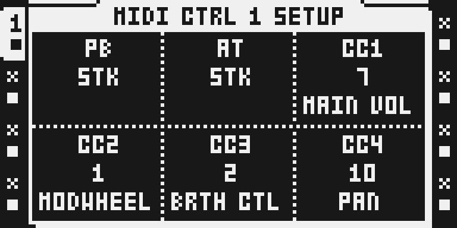
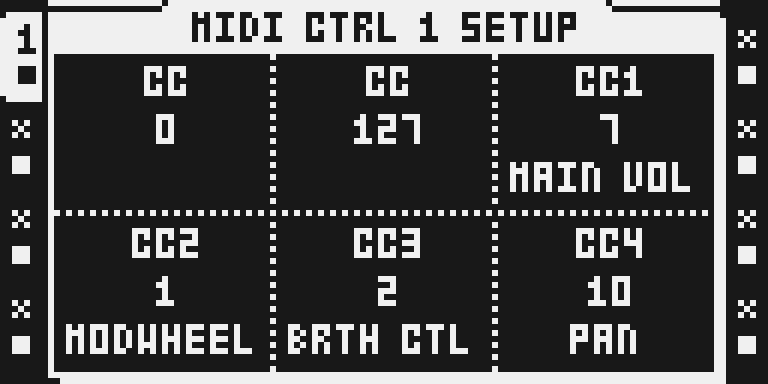
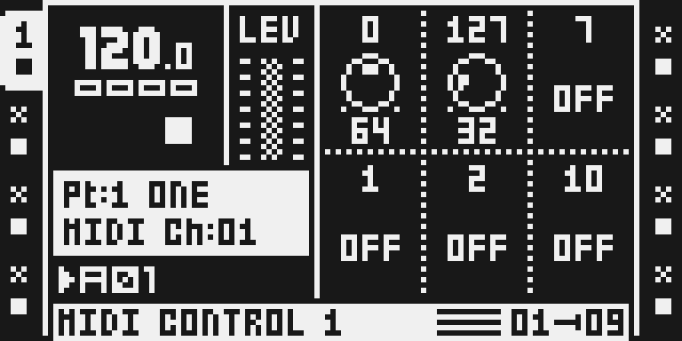
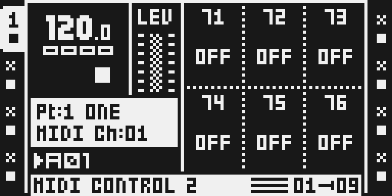
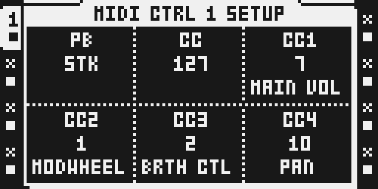

# Midi Mode 2 — emulator walkthrough

Actual firmware LCD pixels from the MKII emulator, captured on 24 October 2026. The images illustrate the current 0.0.4-experimental draft. They are not physical-device photographs or hardware qualification.

## Open the assignment page

Select a MIDI track and double-tap FX1 to open CONTROL 1 SETUP. PB and AT show STK here; click encoder A or B to switch that position into CC mode.

## Choose two controllers

Click A and B in SETUP to switch both positions into CC mode. Each starts at CC0; this example leaves A at CC0 and turns B to CC127, then confirms with YES. Use controller numbers supported by your receiving instrument.

## Send a value

Press FX1 to return to CONTROL 1 and enable A or B with FUNC + encoder press. The headers identify CC0 and CC127; their enabled values are 64 and 32 here. Turn the encoder to send a value on the MIDI track’s output channel.

## Read the other assignments

Press FX2 to view CONTROL 2. Its headers show the assigned CC numbers, here 71–76, instead of slot names. All six values are OFF in this capture; enable a value before sending it.

## Restore pitch bend

Double-tap FX1 and click A again to restore native pitch bend. PB returns to STK while B keeps CC127, so the modes remain independent. Switching A back to CC later starts at CC0.

